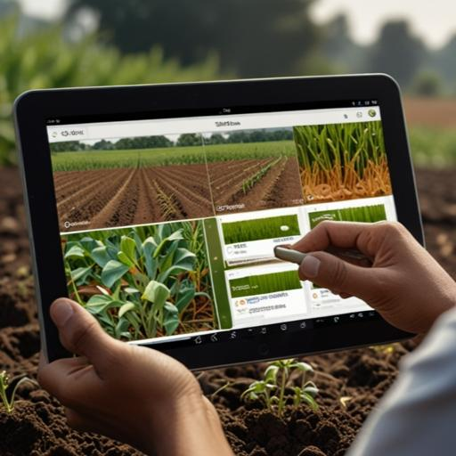

# 🌿 Plant Pulse — Smart Farming Assistant

<p align="center">
  
</p>

<p align="center">
  <b>An AI-powered platform for smart, sustainable agriculture</b>
</p>

---

## 1. Short Description
**Plant Pulse** is an AI-driven agricultural platform that empowers farmers with machine learning-based crop recommendations, CNN-based plant disease detection, real-time weather forecasting, and an integrated generative AI chatbot for tailored farming advice.

## 2. Problem
Farmers often lack access to localized, data-driven agricultural insights. Traditional methods of selecting crops based on soil conditions or diagnosing plant diseases are prone to error, which leads to suboptimal yields and preventable crop losses. Additionally, gathering accurate weather and actionable advice usually requires consulting multiple fragmented sources.

## 3. Solution
Plant Pulse centralizes these solutions into a single, accessible platform. By combining traditional machine learning (Random Forest) for tabular soil data and deep learning (Convolutional Neural Networks) for image classification, the platform provides immediate, highly accurate answers. It complements these AI insights with a web portal featuring real-time external APIs for weather, news, and conversational guidance.

## 4. Features
- **🌾 Crop Recommendation System:** Input 7 soil and climate parameters to predict the best crop using a Random Forest model.
- **🔬 Plant Disease Identification:** Upload an image of a leaf to detect diseases across 38 distinct classes using a pre-trained Keras CNN.
- **🤖 AI Farming Chatbot:** Ask conversational farming questions powered by the Google Gemini 1.5 Flash API.
- **🌤️ Real-Time Weather:** Get live localized weather forecasts via the OpenWeatherMap API.
- **📰 Agricultural News:** Fetch crop-specific agricultural news via NewsAPI.

## 5. Tech Stack
- **Frontend:** HTML5, CSS3, Vanilla JavaScript, Bootstrap 5
- **Machine Learning UI:** Python 3.12, Streamlit
- **Model Training / Inference:** scikit-learn (Random Forest), TensorFlow/Keras (CNN), Pandas, NumPy
- **APIs:** Google Gemini (LLM), OpenWeatherMap (Weather), NewsAPI (News), Google Cloud Translation (Multilingual)

## 6. Architecture
The architecture is completely decoupled for modular development:
- **PLANTPULSE-web-app:** A static HTML/JS frontend that acts as a central hub and directly calls external APIs (Weather, Chatbot, Translate).
- **CROP-RECOMMENDATION:** A standalone Streamlit web application that handles tabular ML classification.
- **PLANT-DISEASE-IDENTIFICATION:** A standalone Streamlit web application that handles image processing and CNN inference.

The central web portal links out to the two local Streamlit servers (`localhost:8501` and `localhost:8502`).

## 7. Screenshots

<p align="center">
  
  
</p>
<p align="center">
  
</p>

## 8. Demo
*Currently running locally. (Link to video demo here if available)*

## 9. Installation
**Prerequisites:** Python 3.10+, Git.

```bash
git clone https://github.com/suhasshetti02/Plant-Pulse.git
cd Plant-Pulse
```

## 10. Environment Variables
For security, API keys are not included in the repository. You must provide your own keys to run the application fully.

1. **Python Backend (Crop Recommendation)**
Create a `.env` file in the `CROP-RECOMMENDATION/` directory:
```env
GEMINI_API_KEY="your_gemini_api_key_here"
NEWS_API_KEY="your_newsapi_key_here"
```

2. **Frontend Web Portal**
Open the following files and replace the placeholder text with your actual API keys:
- `PLANTPULSE-web-app/index.html`: Add your Google Translate API Key on line 331.
- `PLANTPULSE-web-app/chatbot/app.js`: Add your Gemini API Key on line 3.
- `PLANTPULSE-web-app/weather-forecast/script.js`: Add your OpenWeatherMap API Key on line 16.

## 11. Running Locally
You will need to start the two Streamlit servers and open the static HTML file.

**Start Crop Recommendation:**
```bash
cd CROP-RECOMMENDATION
pip install -r requirements.txt
streamlit run app.py
```

**Start Plant Disease Identification:**
```bash
cd PLANT-DISEASE-IDENTIFICATION
pip install -r requirements.txt
streamlit run main.py
```

**Open the Web Portal:**
Open `PLANTPULSE-web-app/index.html` in any modern web browser.

## 12. Testing
Testing is currently manual. Navigate through the web portal to the respective Streamlit apps and verify inputs and outputs.
- Test data for Crop Recommendation can be sourced from `CROP-RECOMMENDATION/Crop_recommendation.csv`.
- Test images for Disease Identification can be found in `PLANT-DISEASE-IDENTIFICATION/test/`.

## 13. Project Structure
```text
PLANT PULSE/
├── CROP-RECOMMENDATION/          # Streamlit app for ML crop prediction
│   ├── app.py                    
│   └── Crop_recommendation.csv   # Dataset used for training
├── PLANT-DISEASE-IDENTIFICATION/ # Streamlit app for CNN disease detection
│   ├── main.py                   
│   └── trained_plant_disease_model.keras
├── PLANTPULSE-web-app/           # Static Hub web portal
│   ├── index.html                
│   ├── chatbot/                  
│   └── weather-forecast/         
└── README.md
```

## 14. API Information
The project consumes external APIs using the following endpoints:
- **Gemini API:** `generativelanguage.googleapis.com` (POST)
- **OpenWeatherMap API:** `api.openweathermap.org/data/2.5/weather` (GET)
- **NewsAPI:** `newsapi.org/v2/everything` (GET)
- **Google Translate API:** `translation.googleapis.com` (POST)

*Note: No internal APIs are exposed. The ML models are served directly via Streamlit UIs.*

## 15. Database Information
There is no traditional relational (SQL) or NoSQL database in this project. The system relies entirely on a flat CSV file (`Crop_recommendation.csv`) for the Crop Recommendation model.

## 16. Limitations
- **Decoupled Architecture:** The system relies on three separately running processes rather than a unified backend.
- **Model Training Overheads:** The Random Forest model currently trains dynamically on script load rather than loading a serialized model.
- **Hardcoded Routes:** The central hub requires the Streamlit apps to run on exactly ports 8501 and 8502.

## 17. Future Improvements
- Centralize the architecture by replacing Streamlit with a unified backend (e.g., FastAPI) and exposing the ML models via REST APIs.
- Pre-load and serialize the `RandomForestClassifier` using `joblib` to speed up initial inference times.
- Move all client-side API requests (Weather, Chatbot) to the backend to completely obscure API keys from the browser.

---
*Developed by Team PlantPulse.*
